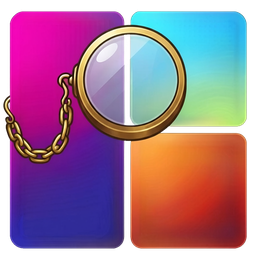
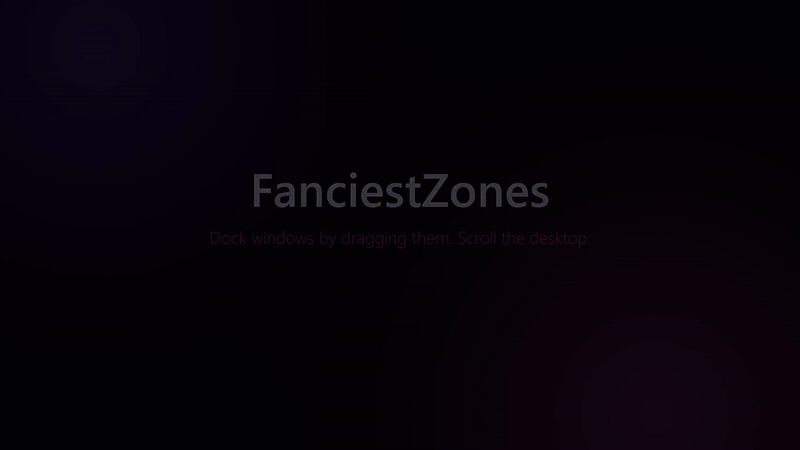

<p align="center">
  
</p>
<h1 align="center">FanciestZones</h1>
<p align="center">Dock windows by dragging them. Split, swap and scroll the desktop. For Windows 10 and 11.</p>

<p align="center">
  
</p>

FanciestZones is a fork of [FancyZones](https://learn.microsoft.com/windows/powertoys/fancyzones) from Microsoft PowerToys. FancyZones snaps windows into zones that you draw in advance. FanciestZones has no zones to draw: you drop a window next to a screen edge or on another window, and the layout builds itself, the way tiling window managers such as [TrellisWM](https://trelliswm.app) (macOS) and Hyprland (Linux) work.

It is one small program that runs on its own. You don't need PowerToys.

> [!NOTE]
> FanciestZones is a personal project. It is not made, supported or endorsed by Microsoft.

## What it does

- **Dock by drag.** Hold Shift while you drag a window. Drop it near a screen edge to give it that half of the screen, or on the outer part of a docked window to split that window. Splits nest as deep as you like.
- **Snap to the side.** Drag a window to the left or right edge of the screen, and it docks there without Shift.
- **Neighbors follow.** Resize a docked window and its neighbors take the rest. Minimize or close one and the others fill the space; restore it and it goes back to its place.
- **Move with the keyboard.** Win+arrows move the focus between docked windows. Shift+Win+arrows swap a window with its neighbor, and its neighbors spring to their new places.
- **Buttons on every window.** Small < > buttons next to the minimize button move a docked window left or right.
- **Flip and resize.** Win+J turns a split around. Win+plus and Win+minus make a window wider or narrower; add Shift for height.
- **Scroll the desktop.** Shift+Win+mouse wheel scrolls the windows of a monitor up and down a tall canvas. Every screen-high page of the canvas has its own layout.
- **Saved layouts.** Save the layout of a monitor to a digit and recall it with a key. Named layouts cover every monitor, and loading one starts the apps that aren't open.
- **Remembers.** Layouts are kept per monitor and per virtual desktop, and survive a restart. After a reboot, apps go back to their places as you open them.
- **Settings in the tray.** Right-click the FanciestZones icon in the notification area to turn features on and off.

## Install

1. Download `FanciestZones-<version>-setup.exe` from the [latest release](https://github.com/c-hurtado/FanciestZones/releases/latest).
2. Run it. It installs for your user only and doesn't ask for administrator rights. Tick **Start FanciestZones when I sign in** if you want it to start with Windows.
3. The FanciestZones icon appears in the notification area. Right-click it for settings.

The files aren't signed yet. Windows SmartScreen may warn before the first run: choose **More info**, then **Run anyway**.

If PowerToys is installed, turn FancyZones off in PowerToys Settings. FanciestZones won't start while FancyZones of PowerToys runs, because both would move the same windows.

To update, run the newer setup; it quits the running copy first. To uninstall, use **Settings > Apps > Installed apps**. Your settings and layouts stay in `%LOCALAPPDATA%\FanciestZones`; delete that folder too to remove everything.

Without the installer: the release also has a zip with `FanciestZones.exe`. Put it in `%LOCALAPPDATA%\FanciestZones` and run it; **Start at sign-in** is in the tray menu.

## Get started

| To | Do this |
|---|---|
| Dock a window to half of the screen | Hold **Shift** and drag it near the left, right, top or bottom edge |
| Dock it without Shift | Drag it all the way to the left or right edge |
| Split a docked window | Hold **Shift** and drop another window on its outer part |
| Undock a window | Drag it without Shift |
| Move the focus | **Win+arrow** keys* |
| Swap two docked windows | **Shift+Win+arrow** keys* |
| Turn a split around | **Win+J** |
| Resize a docked window | **Win+plus**, **Win+minus** (add Shift for height, Alt for small steps, Ctrl for big ones) |
| Scroll the desktop | **Shift+Win** and the mouse wheel |
| Save the layout of a monitor | **Win+Ctrl+Alt+Shift+digit** |
| Recall it | **Win+Ctrl+Alt+digit** |
| Save a named layout of every monitor | **Save layout...** in the tray menu, or `FanciestZones save MyLayout` in a terminal |
| Load it | `FanciestZones load MyLayout`, or the **Load layout** menu of the tray icon |

\* Turn on **Win+arrow keys move docked windows** in the tray menu first. They replace the Windows snap keys only on docked windows.

The [full guide](FanciestZones.md) covers every action, the command line and all settings.

## Settings

Right-click the tray icon:

| Menu item | What it does |
|---|---|
| Dock only while Shift is held | On: docking needs Shift. Off: every drag docks, and Shift turns docking off. |
| Dock at the left and right screen edges | A window dragged to the side edge docks there without Shift |
| Dock new windows by themselves | New windows split the window last in use, as in Hyprland's dwindle layout |
| Win+arrow keys move docked windows | Win+arrows move the focus, Shift+Win+arrows move windows in the layout |
| < > buttons on docked windows | Show the buttons next to the caption buttons |
| Animations | Windows spring to their new places |
| Zoom out while scrolling the desktop | The scroll zooms out to show the pages stacked |
| Gap between windows | Space between docked windows |
| Desktop pages per monitor | How many pages each monitor scrolls through, empty ones included, from 1 (no scrolling) to 4 |
| Save layout... | Name the windows docked now, on every monitor, and save them |
| Load layout | Recall a named layout |
| Start at sign-in | Start FanciestZones with Windows |
| Open settings folder | Opens `%LOCALAPPDATA%\FanciestZones`, where `settings.json` holds every setting |

FanciestZones keeps its settings and layouts in `%LOCALAPPDATA%\FanciestZones`, apart from PowerToys. The first time it runs, it copies the settings and layouts of an earlier FanciestZones from the PowerToys folder, if there are any.

## What it costs to run

Measured on an AMD Ryzen 7 8700F (8 cores, 16 threads) with Windows 11, FanciestZones running but not in use:

| | Measured |
|---|---|
| CPU | 0.4% to 1% of one core, under 0.1% of the whole processor |
| Memory in use (working set) | 66 to 90 MB |
| Memory reserved (private bytes) | 137 MB |
| Threads | 49 to 56 |

The lower figures are with the screen locked, the higher ones while the PC is in use. Most of the memory and threads come from the FancyZones code it is built on; the plan is to cut them by removing the zone engine it no longer uses.

## Build it

FanciestZones builds with Visual Studio 2022 and the **Desktop development with C++** workload. Only the C++ part of the PowerToys code base is needed.

```powershell
git clone https://github.com/c-hurtado/FanciestZones
cd FanciestZones
& "C:\Program Files\Microsoft Visual Studio\2022\Community\MSBuild\Current\Bin\amd64\MSBuild.exe" `
  src\modules\fancyzones\FancyZones\FancyZones.vcxproj -restore -p:RestorePackagesConfig=true `
  -p:Platform=x64 -p:Configuration=Release "-p:SolutionDir=$PWD\\" -m
```

The program is `x64\Release\FanciestZones.exe`, one file with nothing to install beside it. See [the guide](FanciestZones.md#rebuild-it) for the unit tests and the live test.

## Privacy

FanciestZones collects no data and sends nothing anywhere. The PowerToys telemetry is left out of it. It writes a log on your computer, in `%LOCALAPPDATA%\FanciestZones\Logs`.

## License and credits

FanciestZones is released under the [MIT License](LICENSE), like PowerToys, which it is based on. The PowerToys code is Copyright (c) Microsoft Corporation. The program includes [spdlog](https://github.com/gabime/spdlog) and [{fmt}](https://github.com/fmtlib/fmt) (MIT), and builds on the [Windows Implementation Libraries](https://github.com/microsoft/wil) and [C++/WinRT](https://github.com/microsoft/cppwinrt) (MIT). Their notices are in [NOTICE.md](NOTICE.md).

Microsoft, Windows and PowerToys are trademarks of the Microsoft group of companies. FanciestZones is not affiliated with Microsoft. The rest of this repository is the PowerToys code base that FanciestZones is built from; the FanciestZones code is in [`src/modules/fancyzones`](src/modules/fancyzones).
